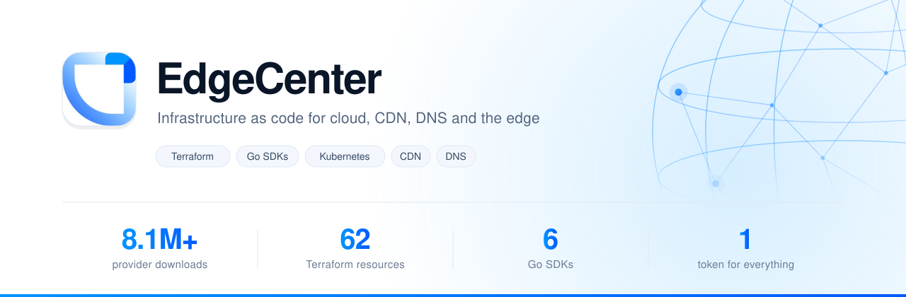

<div align="center">
<picture>
  <source media="(prefers-color-scheme: dark)" srcset="assets/hero-dark.svg">
  
</picture>

<p>
<a href="https://registry.terraform.io/providers/Edge-Center/edgecenter/latest"></a>
<a href="https://pkg.go.dev/github.com/Edge-Center/edgecentercloud-go/v2"></a>
<a href="https://github.com/Edge-Center/edgecenter-docs"></a>
<a href="https://apidocs.edgecenter.ru"></a>
</p>
</div>

## One provider. Every service.

| Compute and network | Edge and delivery | Platform services |
| :--- | :--- | :--- |
| **Instances**<br>`edgecenter_instance` | **CDN**<br>`edgecenter_cdn_resource` | **Kubernetes**<br>`edgecenter_mkaas_cluster` |
| **Load balancers**<br>`edgecenter_loadbalancerv2` | **DNS**<br>`edgecenter_dns_zone` | **Managed databases**<br>`edgecenter_dbaas_cluster` |
| **Block storage**<br>`edgecenter_volume` | **DDoS Protection**<br>`edgecenter_protection_resource` | **Object Storage**<br>`edgecenter_storage_s3` |
| **Security groups**<br>`edgecenter_securitygroup` | **Certificates**<br>`edgecenter_cdn_sslcert` | **Monitoring**<br>`edgecenter_rmon_check_http` |

## Up and running

```hcl
terraform {
  required_providers {
    edgecenter = { source = "Edge-Center/edgecenter", version = "~> 0.14" }
  }
}

provider "edgecenter" {}

resource "edgecenter_network" "app" {
  name       = "app"
  type       = "vxlan"
  project_id = 1
  region_id  = 1
}

resource "edgecenter_cdn_resource" "cdn" {
  cname           = "cdn.example.com"
  origin          = "origin.example.com"
  origin_protocol = "HTTPS"
}
```

```sh
export EC_PERMANENT_TOKEN="your-token"
terraform apply
```

One token, issued once in the control panel, reaches every service above. The
provider reads it straight from the environment.

## Prefer Go?

Each service is a standalone module. Take only what you need.

```go
client, _ := edgecloud.NewWithRetries(nil,
    edgecloud.SetAPIKey(os.Getenv("EC_PERMANENT_TOKEN")),
    edgecloud.SetRegion(1),
    edgecloud.SetProject(1),
)

instances, _, err := client.Instances.List(ctx, nil)
```

| Module | Covers |
| :--- | :--- |
| [edgecentercloud-go](https://github.com/Edge-Center/edgecentercloud-go) | Compute, networking, load balancers, Kubernetes, databases |
| [edgecentercdn-go](https://github.com/Edge-Center/edgecentercdn-go) | CDN resources, rules, origins, certificates |
| [edgecenter-dns-sdk-go](https://github.com/Edge-Center/edgecenter-dns-sdk-go) | Zones and records |
| [edgecenter-storage-sdk-go](https://github.com/Edge-Center/edgecenter-storage-sdk-go) | Buckets and credentials |
| [edgecenterprotection-go](https://github.com/Edge-Center/edgecenterprotection-go) | DDoS Protection |
| [edgecenteredgemon-go](https://github.com/Edge-Center/edgecenteredgemon-go) | Checks, channels, status pages |

## Running Kubernetes with us

- [**edgecenter-ccm**](https://github.com/Edge-Center/edgecenter-ccm) gives your cluster nodes and `LoadBalancer` services
- [**edgecenter-csi**](https://github.com/Edge-Center/edgecenter-csi) gives it persistent volumes on EdgeCenter Disks
- [**external-dns-ec-webhook**](https://github.com/Edge-Center/external-dns-ec-webhook) keeps DNS records following your ingresses

```sh
helm repo add edgecenter https://edge-center.github.io/ec-helm-charts.github.io/
```

<div align="center">

**[Developer docs](https://github.com/Edge-Center/edgecenter-docs)** and the [full repository map](https://github.com/Edge-Center/edgecenter-docs/blob/main/docs/repository-map.md) &nbsp;|&nbsp; [Contributing](https://github.com/Edge-Center/.github/blob/main/CONTRIBUTING.md) &nbsp;|&nbsp; [Security](https://github.com/Edge-Center/.github/blob/main/SECURITY.md)

[edgecenter.ru](https://edgecenter.ru) &nbsp;|&nbsp; [Cloud](https://edgecenter.ru/cloud) &nbsp;|&nbsp; [Knowledge base](https://edgecenter.ru/knowledge-base) &nbsp;|&nbsp; [API reference](https://apidocs.edgecenter.ru)

</div>
